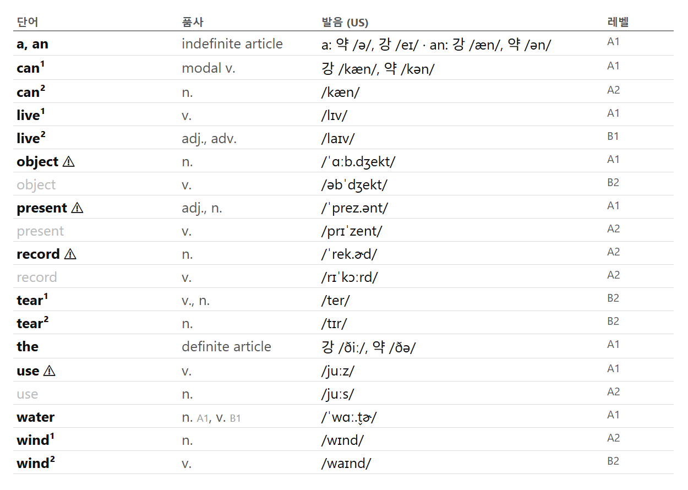

# Oxford 3000 미국식 발음 단어장 생성기

> 발음 정보가 없는 Oxford 3000 단어 목록에 **Cambridge Dictionary의 미국식(US) 발음을 품사별로 자동으로 붙여**, 인쇄용 A4 PDF 단어장을 만드는 파이썬 파이프라인입니다.

| 항목 | 내용 |
|---|---|
| 입력 | Oxford 3000 (American English) PDF |
| 발음 출처 | Cambridge Dictionary |
| 결과물 | A4 2단 PDF 단어장 31쪽 |
| 규모 | 표제어 3,000개, 품사 행 3,768개, 발음 누락 **0건** |
| 도구 | Python 3.12, BeautifulSoup, Markdown, Poppler `pdftotext`, Microsoft Edge |

---

## 프로젝트 목적

영어 단어는 스펠링만 보고 정확한 발음을 알기 어렵습니다. 그래서 단어를 외우는 단계에서부터 정확한 발음을 함께 익힐 수 있도록, Cambridge Dictionary의 발음기호를 단어 옆에 나란히 표기한 **나만의 단어장**을 만들었습니다.

---

## 진행 과정

### 1. 파이프라인

각 단계의 결과를 파일로 남겨, 중간 단계부터 다시 실행할 수 있게 했습니다.

```text
American_Oxford_3000.pdf
  │ pdftotext
  ▼
oxford3000_raw.txt
  │ 1_parse.py      단어, 동형어 번호, 의미 구분, 품사, 레벨 분리
  ▼
words.json
  │ 2_fetch.py      Cambridge 페이지를 받아 cache/에 압축 저장
  │ 3_extract.py    품사에 맞는 US 발음 선택 (+ overrides.json)
  ▼
words.json + review.csv
  │ 4_build.py      표 생성 (+ extras.csv)
  ▼
oxford3000.md → oxford3000.html → oxford3000.pdf
```

### 2. 발음 선택 기준

신뢰도가 높은 출처부터 차례로 찾습니다. 3,768개 품사 행 중 98.5%가 2순위인 학습자 사전의 같은 품사에서 나왔습니다.

| 순위 | 출처 | 품사 행 수 |
|---:|---|---:|
| 1 | 사람이 확인한 값 (`overrides.json`) | 23 |
| 2 | 학습자 사전(`cald4`)의 같은 품사 | 3,712 |
| 3 | `cald4`의 다른 품사 (단어 전체 발음이 하나뿐일 때) | 29 |
| 4 | `cald4` 느슨한 매칭 (`rely on` 같은 구동사 표제어 포함) | 2 |
| 5 | 미국 사전(`cacd`) | 2 |

다른 품사에서 가져왔거나 후보가 여러 개인 40행은 `review.csv`에 따로 남겨 사람이 확인할 수 있게 했습니다.

### 3. 해결한 문제

| 문제 | 해결 |
|---|---|
| PDF 줄바꿈으로 항목 하나가 여러 줄로 잘림 | 레벨(`A1`~`B2`)이 나올 때까지 줄을 이어 붙여 한 항목으로 복원 |
| 옥스퍼드와 Cambridge의 품사 표기가 다름 | 품사 대응표를 두고, 복합 품사(`det./pron.`)는 나눠서 매칭 |
| 품사에 따라 발음이 다름 (`record`, `use`) | 사전의 품사 블록별로 발음을 찾아 줄을 나누고 ⚠ 표시 |
| 한 페이지에 약어가 함께 실림 (`IT`와 `it`, `cup`과 `CUP`) | 표제어와 품사로 거르고, 후보가 남으면 첫 번째를 쓰되 `review.csv`에 기록 |
| 복수형, 과거형 발음이 섞임 (`house`의 복수형) | 변화형 영역은 추출에서 제외 |
| 약형 발음이 US 표시 블록 바깥에 있음 (`the`, `for`) | 바로 앞의 지역 표시를 기준으로 미국식 여부를 판단 |
| 철자가 같은 다른 단어는 자동 구분이 어려움 (`tear`, `wind`, `used`) | `overrides.json`에 사람이 값을 넣고 근거를 `_notes`에 기록 |
| 약 3,000번 요청하면 서버 부담과 중단 위험이 있음 | 요청 간격 1~2초, 재시도, 페이지 캐시로 이어서 실행 가능 |

---

## 결과

### 단어장 예시

실제 빌드 코드로 일부 단어만 뽑아 만든 예시입니다. 완성본은 알파벳순으로 실립니다.



| 표시 | 뜻 | 예시 |
|---|---|---|
| ⚠ | 품사에 따라 발음이 달라지는 단어 (39개) | `record` 명사 /ˈrek.ɚd/(레커드), 동사 /rɪˈkɔːrd/(리코어드) |
| ¹ ² | 철자가 같은 다른 단어 | `wind¹` /wɪnd/(윈드, 바람), `wind²` /waɪnd/(와인드, 감다) |
| 강 / 약 | 강조할 때와 문장 속 보통 발음 | `the` 강 /ðiː/(디이), 약 /ðə/(더) |
| † | 학습자 사전에 없어 미국 사전 표기를 쓴 항목 (3개 행) | `goods` /ɡʊdz/(굳즈) |
| 레벨 | CEFR A1~B2. 품사별 레벨이 다르면 품사 옆에 표기하고, 레벨 열에는 가장 낮은 레벨을 표시 | `water` n. A1, v. B1 |

### 수치

| 항목 | 값 |
|---|---:|
| 표제어 | 3,000 |
| 품사 행 → 합친 뒤 표의 줄 수 | 3,768 → 3,041 |
| 발음 누락 | 0 |
| 레벨별 품사 행 (A1 / A2 / B1 / B2) | 1,054 / 977 / 900 / 837 |
| 사람이 입력한 품사 행 | 23 |
| 재확인 목록 (`review.csv`) | 40 |

### 검증 (2026-11-06)

| 항목 | 결과 |
|---|---|
| 처음부터 재실행 | `raw`, `words.json`, `review.csv`, `extras.csv`, `md`, `html` 모두 바이트 단위로 동일 |
| 저장소 파일만으로 실행 | 저장소 파일과 새 가상환경에 원본 PDF와 사전 캐시만 더해 실행, 결과 동일 |
| PDF | 추출 텍스트 동일, 31쪽 |
| 데이터 구조 | 중복 항목 0건, 품사 없는 항목 0건 |
| 발음 지역 | 자동 추출 로직과 표본 HTML에서 US 표시 뒤의 값만 사용함을 확인 |

이 검증은 코드가 입력 데이터를 의도대로 처리했는지 확인한 것입니다. 사전에 실린 발음 자체의 정확성까지 보증하지는 않습니다. `2_fetch.py`의 네트워크 수집은 캐시를 재사용했기 때문에 이 검증에서 다시 실행하지 않았습니다.

---

## 실행 방법

### 준비물

- Python 3.12 (이 버전으로 검증)
- `pdftotext` (Poppler)
- Microsoft Edge (`4_build.py`의 `EDGE`에 Windows 기본 경로가 고정되어 있음)
- Oxford 3000 (American English) PDF

```bash
pip install -r requirements.txt

# UTF-8 옵션이 없으면 환경에 따라 1_parse.py에서 인코딩 오류가 납니다.
pdftotext -raw -enc UTF-8 American_Oxford_3000.pdf oxford3000_raw.txt

python 1_parse.py     # words.json 생성
python 2_fetch.py     # 단어당 1~2초 간격, 전체 1시간 이상
python 3_extract.py   # 발음 기입, review.csv 생성 (수 분)
python 4_build.py     # md, html, pdf 생성
```

- `2_fetch.py`는 이미 받은 단어를 건너뛰므로, 중단해도 이어서 실행할 수 있습니다.
- `1_parse.py`는 `words.json`을 새로 쓰면서 발음을 지웁니다. 실행했다면 `3_extract.py`와 `4_build.py`도 다시 돌려야 합니다.

### 수정과 확장

- **발음 고치기:** `overrides.json`에 `"단어|동형어번호|의미구분|품사": "/발음/"`을 넣고 3, 4단계를 다시 실행합니다.
- **열 추가하기:** `extras.csv`에 `뜻` 같은 열을 추가해 값을 채우고 `4_build.py`를 다시 실행합니다. 값이 있는 열만 표에 나타나고, 너비는 자동으로 조정됩니다. `key`, `word`, `pos` 열은 행을 찾는 데 쓰므로 수정하면 안 됩니다.

---

## 폴더 지도

```text
.
├── README.md          이 문서
├── 1_parse.py         PDF 텍스트 → 단어 목록
├── 2_fetch.py         Cambridge 페이지 수집
├── 3_extract.py       품사별 US 발음 선택
├── 4_build.py         Markdown, HTML, PDF 생성
├── overrides.json     수동 발음 수정과 근거
├── requirements.txt   파이썬 패키지 목록
└── docs/sample.png    결과 예시 이미지
```

## 저장소에 없는 파일

저작권 때문에 아래 파일은 저장소에 넣지 않았습니다. 제외 규칙은 [.gitignore](.gitignore)에 있습니다.

| 파일 | 내용 |
|---|---|
| 원본 PDF, `oxford3000_raw.txt` | Oxford 3000 원본과 추출 텍스트 |
| `cache/`, `fetch.log` | 수집한 사전 페이지와 수집 로그 |
| `words.json`, `extras.csv`, `review.csv` | 단어 목록과 발음이 담긴 중간 데이터 |
| `oxford3000.md`, `.html`, `.pdf` | 완성된 단어장 |

## 알려진 한계와 향후 과제

- [ ] 한국어 뜻 열 추가
- [ ] 미국식 발음 기호(`ɚ`, `ɝ`, `t̬`, `ˈ`, `ˌ`) 안내 페이지
- [ ] 발음 유형별로 묶어 보는 정렬 (지금은 알파벳순)
- [ ] 변화형 발음 표기 (예: `read`의 과거형 /red/, 레드)
- [ ] Edge 경로와 PDF 출력 위치를 설정으로 분리
- [ ] 수동으로 넣은 발음 재확인: `used¹`, `used²`, `impressed`, `located`, `based`, `next to`, `vitamin`, `survey`(동사)

## 출처와 이용 범위

개인 학습 목적으로 만든 프로젝트이며, Oxford University Press나 Cambridge University Press와 관련이 없습니다.

- 단어 목록의 저작권은 Oxford University Press에 있습니다.
- 발음 데이터의 출처는 Cambridge Dictionary입니다. 수집한 페이지와 그 결과물은 재배포하지 않습니다.
- `2_fetch.py`를 실행하기 전에 해당 사이트의 이용 약관을 직접 확인하세요.
